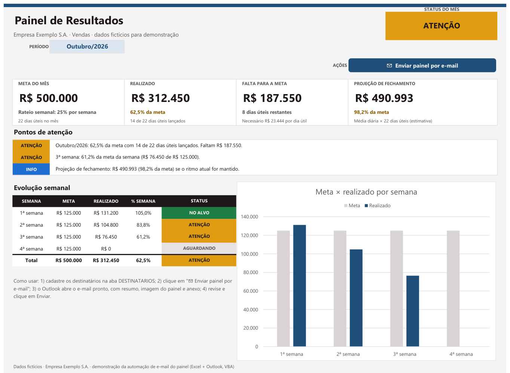
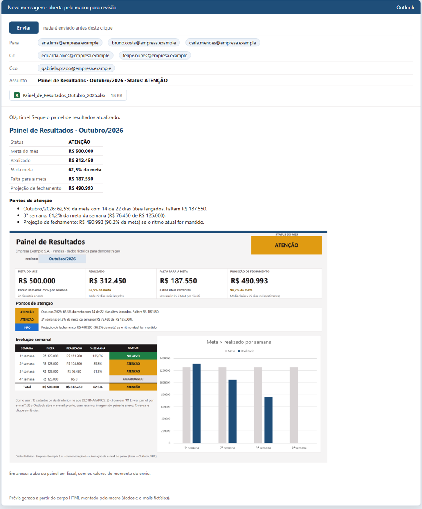

# Automação de e-mail do painel · Excel + Outlook (VBA)

Um botão no painel do Excel monta, no Outlook, um e-mail **pronto para revisar**. Ele já vem com o print do painel, um resumo dos indicadores, os pontos de atenção e um anexo `.xlsx` só com a aba do painel. **Nada é enviado sem você clicar em Enviar.**


▶️ Vídeo em melhor qualidade: [`docs/demo.mp4`](docs/demo.mp4) (35 s)

> A demonstração usa uma empresa fictícia (**Empresa Exemplo S.A.**), números fictícios e e-mails no domínio reservado `.example`, que não existe na internet.

## O que o e-mail leva

| Item | Detalhe |
|---|---|
| **Assunto** | `Painel de Resultados · Outubro/2026 · Status: ATENÇÃO` (título, período e status lidos da planilha) |
| **Destinatários** | Para, Cópia e Cópia oculta, vindos da aba `DESTINATARIOS`; quem está com Ativo = "Não" fica de fora |
| **Resumo** | Tabela com os indicadores que você escolher (por exemplo, meta, realizado, % da meta, falta e projeção) |
| **Pontos de atenção** | Lista com os textos de um intervalo do painel |
| **Imagem do painel** | PNG em alta resolução no corpo do e-mail, sem os botões; lê bem no celular |
| **Anexo `.xlsx`** | Só a aba do painel, com os valores congelados no momento do envio. Gráficos viram imagens; não vão fórmulas, macros, nomes nem ligações com a planilha original |
| **Assinatura** | A sua assinatura padrão do Outlook é mantida |

| Painel na planilha | E-mail gerado (prévia) |
|---|---|
|  |  |

## Requisitos

- **Excel para Windows** (2010 ou mais novo), com o arquivo salvo como `.xlsm`.
- **Outlook clássico** instalado e configurado com a sua conta.
  - O "novo Outlook" e o Outlook na Web **não** aceitam automação por VBA.
- Macros habilitadas para o arquivo: clique em **Habilitar Conteúdo** na barra amarela.

## Instalação

1. **Importe o módulo.** No Excel, pressione `Alt + F11` › **Arquivo › Importar Arquivo…** › escolha [`src/modEmailPainel.bas`](src/modEmailPainel.bas).
2. **Crie a aba `DESTINATARIOS`** com este layout (veja [`exemplos/destinatarios_exemplo.csv`](exemplos/destinatarios_exemplo.csv)):

   | Coluna | B | C | D | E |
   |---|---|---|---|---|
   | Linha 5 (cabeçalho) | NOME | E-MAIL | ENVIO | ATIVO |
   | Linhas 6 a 55 | Ana Lima | ana.lima@empresa.example | Para · Cópia · Cópia oculta | Sim · Não |

   - Envio vazio conta como **Para**, e Ativo vazio conta como **Sim**.
   - A célula `C58` guarda a primeira frase do e-mail (opcional).
3. **Crie o botão.** Na aba do painel: **Inserir › Formas**. Dê à forma um nome que comece com `btn_` (por exemplo, `btn_EnviarEmail`), para ela não aparecer no print. Depois, clique com o botão direito › **Atribuir Macro…** › `EnviarPainelPorEmail`.
4. **Ajuste a configuração** no topo do módulo (tabela abaixo).
5. Salve como **Pasta de Trabalho Habilitada para Macro do Excel (`.xlsm`)**.

## Configuração (topo de `modEmailPainel.bas`)

| Constante | Exemplo | Para que serve |
|---|---|---|
| `TITULO` | `"Painel de Resultados"` | Título no assunto e no corpo |
| `ABA_PAINEL` | `"PAINEL"` | Aba do painel |
| `AREA_PAINEL` | `"A1:O35"` | Área que vira imagem e anexo |
| `CEL_PERIODO` | `"C5"` | Célula com o período (ex.: `Outubro/2026`) |
| `CEL_STATUS` | `"L3"` | Célula com o status (`""` = sem status no assunto) |
| `RESUMO` | `"Meta do mês\|B10;Realizado\|E10"` | Indicadores do resumo, no formato `Rótulo\|Célula;…`. O texto é lido como aparece na tela |
| `AREA_ALERTAS` | `"C14:C16"` | Pontos de atenção (`""` = sem) |
| `LINHA_ACOES` | `7` | Linha dos botões, ocultada durante a captura (`0` = nenhuma) |
| `PREFIXO_BOTAO` | `"btn_"` | Formas com esse prefixo não aparecem no print nem no anexo |
| `SENHA_PAINEL` | `""` | Senha de proteção da aba do painel, se houver |
| `ABA_DEST`, `DEST_PRIMEIRA`, `DEST_ULTIMA`, `CEL_ABERTURA` | `"DESTINATARIOS"`, `6`, `55`, `"C58"` | Onde ficam os destinatários e a frase de abertura |
| `COR_TITULO`, `LARGURA_IMG_EMAIL`, `ESCALA_IMG` | `"#1F4E79"`, `900`, `1.6` | Aparência do e-mail e nitidez da imagem |

## Testar sem enviar nada

No Editor VBA (`Alt + F11`), abra a **Janela Imediata** (`Ctrl + G`) e digite:

```vb
? GerarEmailPainel(True)
```

A macro monta o e-mail e o **descarta**: não envia e não salva rascunho. Ela devolve o assunto, os destinatários, a quantidade de anexos e o caminho dos arquivos gerados em `%TEMP%`, incluindo o corpo do e-mail em HTML, para você conferir.

## Como funciona

1. **Imagem:** `Range.CopyPicture` com aparência de impressão. Captura o painel sem grade e sem depender da tela; a linha de botões é ocultada só durante a captura. Depois a imagem é colada num gráfico temporário e exportada como PNG.
2. **Anexo:** uma pasta nova recebe colagem especial (larguras, valores e formatos). As cores dos formatos condicionais são fixadas a partir de `DisplayFormat`, os gráficos são colados como imagens, as ligações são removidas e o arquivo é salvo como `.xlsx`.
   - A aba não é copiada inteira de propósito: assim o anexo não leva fórmulas nem nomes ocultos (`_xlfn.*`), que podem impedir a cópia de abas.
3. **E-mail:** `Outlook.Application` › `CreateItem`. A imagem entra no corpo por `Content-ID` (`cid:`). O e-mail é aberto com `.Display` para revisão, e o corpo é inserido antes da assinatura.
4. **Erros:** a mensagem informa a etapa que falhou. O painel volta ao estado original, e pastas temporárias abertas são fechadas.

## Segurança

- O e-mail **nunca é enviado automaticamente**: a macro usa `.Display`, não `.Send`.
- Prefira manter o Excel em **"Desabilitar macros VBA com notificação"** e habilitar o conteúdo só deste arquivo. Evite "Habilitar todas as macros".
- Os arquivos temporários (PNG e XLSX) são apagados depois que o e-mail abre.

## Estrutura

```
src/modEmailPainel.bas              módulo VBA (Windows-1252, CRLF: pronto para importar)
exemplos/destinatarios_exemplo.csv  layout da aba DESTINATARIOS com e-mails fictícios
docs/demo.mp4 · docs/demo.gif       vídeo de demonstração
docs/painel.png · docs/email.png    capturas da demonstração
```

## Observações

- O `.bas` está em **Windows-1252 com quebras CRLF**, que é o formato que o Editor VBA espera. Em UTF-8, textos como "Não" e "Cópia" chegariam corrompidos ao importar. O `.gitattributes` preserva esse formato.
- O vídeo foi montado a partir de capturas reais da planilha de demonstração rodando a macro. A tela do e-mail é uma prévia renderizada do corpo HTML que a macro gera.

---
Feito por [T-dosS](https://github.com/T-dosS).
